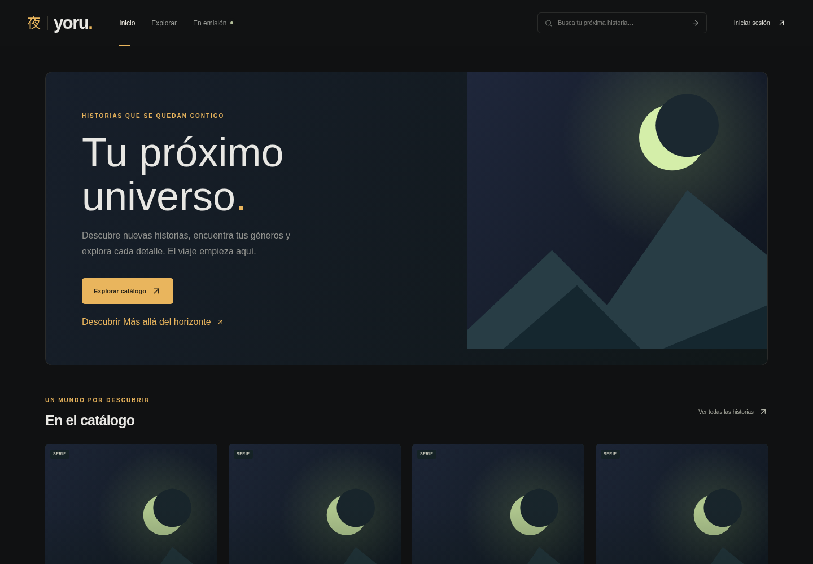
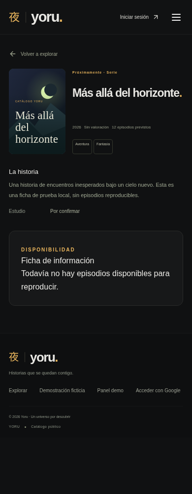

# FASE 3C · catálogo público persistente

Inicio, `/catalogo` y `/anime/:uuid` consultan Supabase. No hay fallback a los fixtures. Los títulos ficticios permanecen en `/demo`, `/demo/catalogo`, `/demo/anime/:slug` y `/demo/admin`; el reproductor demo y su clip original se conservan. Las rutas antiguas de episodios públicos no reproducen contenido ficticio para fichas reales.

## Aplicación manual de SQL (propietario)

No se ha ejecutado SQL remoto ni se han publicado fichas reales desde este desarrollo.

1. Verificar en Supabase que las migraciones anteriores están aplicadas, especialmente `20261012010000_anime_catalog.sql` y `20261012020000_episode_management.sql` (y las migraciones de perfiles existentes). No volver a ejecutar las anteriores si ya están aplicadas.
2. Revisar y ejecutar **solo** `supabase/migrations/20261022190000_public_catalog.sql` en SQL Editor como el propietario `postgres` de Supabase. La migración es transaccional. El propietario de la vista y las funciones debe conservar la capacidad de acceder a las tablas protegidas; no reasignarlo al rol frontend. No ejecutar con `anon` o `authenticated`.
3. Comprobar `public.public_anime`, `yoru_search_anime`, `yoru_catalog_facets` y `yoru_set_anime_publication` en el esquema API `public`. Si PostgREST aún no ve las RPC, esperar a la recarga de esquema de Supabase y recargar la Preview.
4. La migración no crea animes, no publica borradores, no modifica episodios ni permisos de AniList. Los estados `published` preexistentes pasan a mostrar sus metadatos sin necesitar episodios; revisar esos estados antes de aplicar si se usaron en pruebas anteriores.
5. Conservar las variables públicas `VITE_SUPABASE_URL` y `VITE_SUPABASE_PUBLISHABLE_KEY` de Cloudflare Builds, tanto Production como Preview, y sus bindings runtime existentes. No añadir `service_role` ni secretos en `VITE_*`.

La migración no es idempotente: aplicar una sola vez y registrar su aplicación. Para revertir la experiencia web, restaurar el commit anterior; para volver al contrato de base de datos anterior hace falta una migración compensatoria revisada. No eliminar tablas ni volver a ejecutar las migraciones iniciales. Si se necesita ocultar una ficha inmediatamente, usar **Retirar ficha** en `/admin`.

## Contrato público y permisos

- `public_anime` es una vista con `security_barrier`, propiedad del rol de migración. Su elevación es deliberada: proyecta una lista explícita de metadatos y siempre exige `yoru_is_public_anime(id)`, incluso para administradores. No usar `SELECT *` sobre tablas base en una futura modificación de la vista, ni añadir una excepción para administradores.
- La visibilidad exige `catalog_publication.state = 'published'`. Si el origen es AniList, también exige permiso de metadatos vigente. AniList sigue desactivado; no se cambian sus permisos ni se usa su API para el catálogo público.
- Ninguna referencia de reproducción, evidencia de autorización, origen administrativo, fecha interna o membresía sale por la vista. `playback_available` es únicamente un booleano derivado de un episodio disponible, autorizado, con fecha válida y referencias completas. No autoriza ni implementa un reproductor persistente.
- Las tablas base son administrativas y conservan RLS y FORCE RLS. Se retira el permiso SELECT de `anon` sobre tablas administrativas. `authenticated` conserva lectura bajo la política de administrador; un usuario normal recibe cero filas. No hay permisos directos de escritura ni cambios en el esquema privado de membresía.
- `yoru_set_anime_publication` requiere cuenta administradora en cada llamada, confirmación explícita y un ID existente. Serializa sobre el anime y no cambia episodios. La retirada sigue permitida aunque se revoque el permiso del proveedor.
- Las futuras relaciones de favoritos, comentarios y seguimiento deberán usar el UUID persistente, políticas propias y la visibilidad pública vigente. No se crean tablas ni escrituras de esas funciones. Los comentarios simulados solo existen en la demo.

## Consultas y rendimiento

- `yoru_search_anime` aplica búsqueda sin distinguir mayúsculas/acentos españoles, filtros, orden y paginación en PostgreSQL. La entrada de búsqueda es literal (sin SQL dinámico ni comodines interpretados), de hasta 100 caracteres. Se incluyen títulos alternativos y géneros.
- El navegador solicita 25 filas como máximo, presenta 24 y usa la extra para habilitar **Siguiente**. No descarga todo ni solicita un recuento completo. Portada muestra hasta 12 de esa primera página. Los UUID desempatan el orden. Cambiar filtros reinicia página; URL, recarga y atrás preservan la selección.
- Búsqueda con espera de 250 ms, cancelación y límite temporal. Nunca se conserva una ficha de otro ID mientras llega la siguiente. Carga, error con reintento y catálogo vacío son estados separados.
- Índices por año, título, puntuación, géneros y estado de publicación. Los filtros y órdenes pueden aprovecharlos; la búsqueda literal por subcadena requiere evaluar texto en el servidor. Para catálogos mucho mayores, medir `EXPLAIN ANALYZE` y considerar una proyección normalizada con trigramas o búsqueda de texto, manteniendo el mismo DTO público. No se afirma haber medido rendimiento remoto.
- Se usa paginación por offset acotado (máximo 100000). Las modificaciones concurrentes pueden desplazar páginas entre consultas; una futura navegación por cursor puede conservar el servicio y componentes. No hay caché persistente de fichas retiradas.
- Rutas de administración y demo se cargan bajo demanda. No introducen fixtures ni el reproductor en el bundle inicial del catálogo real.

## Imágenes

`public/artwork/catalog-placeholder.svg` es una ilustración geométrica original creada para YORU, compartida como imagen provisional. No pretende ser el póster oficial de cada título; las fichas lo identifican como ilustración provisional. No se solicita ninguna imagen a AniList. La incorporación de portadas autorizadas por título queda preparada mediante el componente público separado, sin exponer URLs administrativas o importar contenidos sin permiso.

## Comprobar la Preview

1. Abrir la PR y esperar el check/deployment de **Cloudflare Preview**. Abrir su URL desde el check; Production no debe desplegarse manualmente.
2. Si falta el callback, añadir manualmente en Supabase Authentication → URL Configuration → Redirect URLs el origen exacto:
   `https://feat-yoru-public-catalog-anime-platform.cuentagaming1304.workers.dev/auth/callback`.
   No cambiar Site URL ni añadir comodines. El frontend solo autoriza ese origen HTTPS exacto además de los existentes. Si Cloudflare muestra otro origen, debe revisarse explícitamente antes de OAuth.
3. Aplicar la migración incremental anterior. Antes de aplicarla, los errores del catálogo son esperables; no se sustituyen por datos ficticios.
4. Acceder con Google como administrador a `/admin`. Crear una ficha local con sinopsis, géneros y año, sin temporadas ni episodios. Cancelar **Publicar ficha**: debe seguir en borrador. Aceptar: debe mostrar **Publicado** y **Ver ficha pública**.
5. En una ventana privada, comprobar Inicio → Explorar → ficha, búsqueda por título alternativo/género, filtros, orden y navegación. La ficha debe indicar que todavía no tiene episodios reproducibles, sin player ni comentarios falsos.
6. Crear un segundo borrador. Comprobar como anónimo y usuario normal que su UUID no revela título, sinopsis ni géneros. La vista pública tampoco debe mostrarlo al administrador. Un usuario normal no debe acceder al CRUD.
7. Retirar la ficha publicada y recargar Inicio, resultados y su enlace directo en ventana privada. Debe desaparecer y mostrar página de ficha inexistente. Volver a publicar debe restaurarla con el mismo UUID.
8. Con más de 24 fichas, comprobar siguiente/anterior, filtros conservados y que cada llamada de búsqueda solicita un máximo de 25 filas. Verificar en Network que no hay `playback_reference`, `authorization_reference` ni llamadas a AniList en respuestas públicas.
9. Verificar OAuth/perfil y `/demo/anime/el-viaje-de-aoi/episodio/1` con el clip original. Probar desconexión/reintento, catálogo sin fichas publicadas y móvil de 390 px.

Las pruebas E2E usan respuestas Supabase simuladas; la autorización real se verifica en PostgreSQL local con PGlite. La configuración remota de Supabase/OAuth y el deployment automático deben comprobarse por separado mediante estos pasos.

## Pruebas locales

- `npm test`: 54 aprobadas, con PostgreSQL/PGlite, RLS, revocación de administradores, permisos de proveedor, metadatos sin episodios, retirada y 2.000 fichas.
- E2E frontend: primera ejecución completa con 81 aprobadas, 3 fallidas y 2 omitidas del Worker. Tras corregir la etiqueta accesible de filtros y aislar las comprobaciones afectadas, repetición de 12 casos con 12 aprobadas en escritorio y móvil. Los 84 casos frontend quedan validados en ejecuciones separadas. El ensayo de decenas de transiciones de vídeo dispone ahora de 90 s en ejecutores compartidos; no se modifica el reproductor.
- Worker local con Wrangler: 2/2 pruebas HTTP aprobadas (POST anónimo devuelve 401 y JSON). En total, 86 casos E2E validados en ejecuciones separadas.
- Compilación TypeScript/Vite correcta. Se conserva un aviso no bloqueante por el bundle principal mayor de 500 kB; administración, fixtures y reproductor demo se separan en chunks bajo demanda.
- Inicio, Explorar y ficha a 320, 390, 768 y 1440 px: sin desbordamiento horizontal. `git diff --check` correcto.

## Capturas de validación local

Datos de prueba y respuestas Supabase simuladas; no acreditan publicación de fichas reales ni cambios remotos.

| Inicio · escritorio | Ficha · móvil |
| --- | --- |
|  |  |
