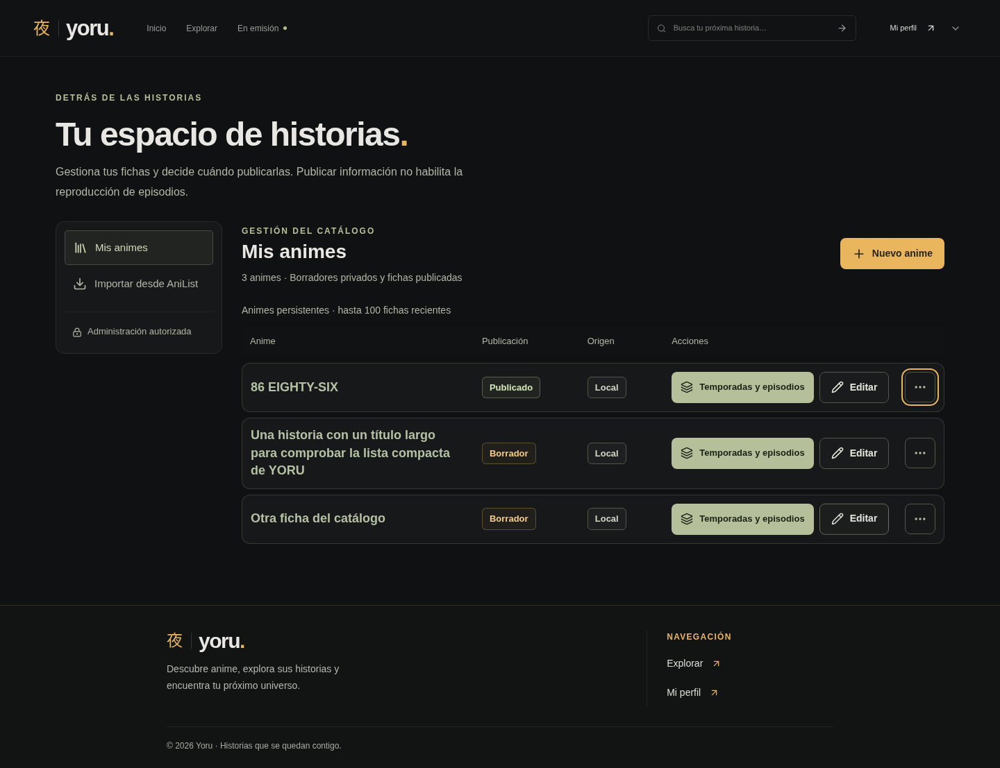
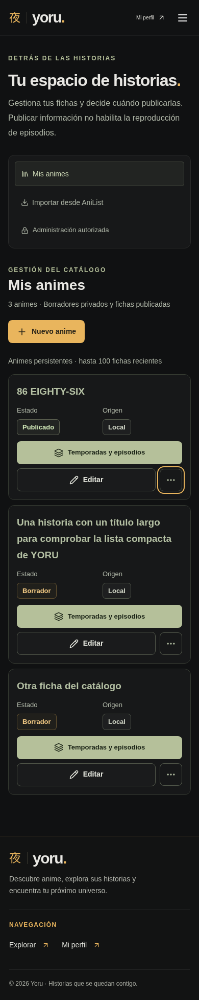
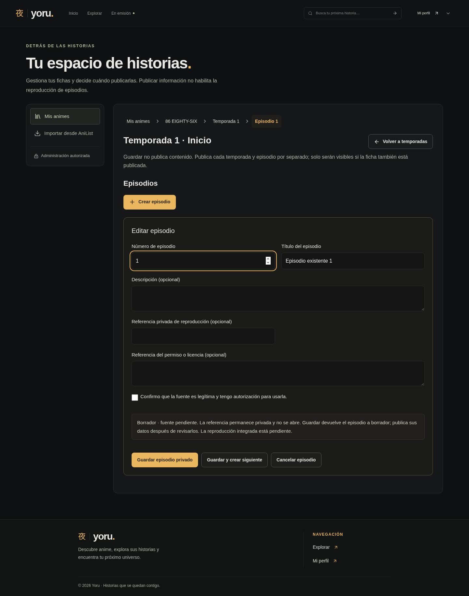
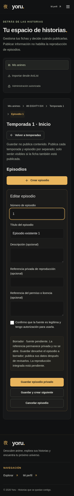

# YORU · administración por niveles y episodios consecutivos

Capturas locales con animes, temporadas y episodios simulados en los E2E. No se han consultado ni modificado datos de Production para estas imágenes.

| Vista | Escritorio · 1440 px | Móvil · 390 px |
| --- | --- | --- |
| Mis animes · lista compacta | [Captura](mis-animes-1440.png) | [Captura](mis-animes-390.png) |
| Temporadas y breadcrumb del anime | [Captura](temporadas-1440.png) | [Captura](temporadas-390.png) |
| Edición de episodio · ruta completa | [Captura](editar-episodio-1440.png) | [Captura](editar-episodio-390.png) |
| Guardado y siguiente episodio preparado | [Captura](crear-siguiente-1440.png) | [Captura](crear-siguiente-390.png) |

## Navegación

La ruta permite volver a Mis animes, las temporadas del anime o los episodios de la temporada sin recargar la aplicación. Durante la edición añade el número de episodio; el nivel actual tiene `aria-current="page"` y contraste ámbar. Los niveles anteriores son botones con foco visible. Al volver a una lista se enfoca su región; al preparar el siguiente episodio se enfoca el título.

Las temporadas permanecen en el estado de `SeasonManager`. Sus episodios se conservan en una caché en memoria limitada al anime abierto, reutilizada al regresar a una temporada. Las mutaciones actualizan o invalidan esa caché, y «Actualizar episodios» permite recargarla para recoger cambios de otra sesión. Cerrar el anime o salir del panel libera ese contexto; no se guarda en almacenamiento local.

Los formularios de anime, temporada y episodio comparan sus datos con el estado inicial. Breadcrumbs, Cancelar y cambios de formulario solicitan confirmación antes de descartarlos. El panel registra un único bloqueo de navegación para enlaces y el historial del navegador, además del aviso nativo al recargar/cerrar la pestaña. Se usa `createBrowserRouter` y `useBlocker` de la dependencia existente de React Router; se conservan todas las rutas y redirecciones. La regresión completa incluye autenticación y navegación pública por este cambio de infraestructura.

## Guardar y crear siguiente

La opción normal «Guardar episodio privado» se conserva. «Guardar y crear siguiente» utiliza el mismo servicio de guardado, espera la lista actualizada y prepara el primer número libre posterior al guardado, omitiendo números ocupados de la misma temporada. Crear desde la lista propone el primer número positivo libre.

El nuevo formulario limpia título, descripción, referencia de reproducción, referencia de licencia y confirmación de autorización. Las validaciones y las reglas de publicación existentes se mantienen: guardar devuelve el episodio a borrador. El control de envío impide dobles solicitudes y las restricciones existentes de la base de datos siguen protegiendo las carreras entre sesiones.

Si falla el guardado, se conservan los campos. Si el guardado termina pero falla la lectura posterior, se informa de que ya está guardado: el reintento solo recarga la lista, sin volver a crear el episodio. El límite de numeración permanece en 2147483647; si no existe un número posterior, se conserva el guardado y se informa al usuario.

## Mis animes

Las filas reducen padding y separación, mantienen nombres destacados y etiquetas «Publicado»/«Borrador». La acción «Temporadas y episodios» y Editar permanecen a mano. El control de más acciones agrupa publicar/retirar, ficha pública y eliminar; funciona con teclado y Escape devuelve el foco al control. Las confirmaciones destructivas y los permisos anteriores permanecen intactos. En móvil las filas se presentan como tarjetas.

## Validación

- Build TypeScript/Vite y `git diff --check` correctos. Permanece el aviso conocido de bundle principal mayor de 500 kB.
- 47/47 pruebas unitarias y PostgreSQL/RLS aprobadas.
- 106 casos E2E frontend validados entre la suite completa y la repetición final de los flujos administrativos. La ejecución amplia aprobó 105 casos y detectó una espera incorrecta del diálogo en un test móvil; tras corregirla, la repetición administrativa aprobó sus 16 casos en escritorio/móvil. Los dos casos HTTP específicos de Worker se omiten en el servidor Vite, como establece la suite.
- Los nuevos casos cubren todos los niveles del breadcrumb, conservación de campos al rechazar la salida, edición/creación, guardado normal y consecutivo, salto de números ocupados, limpieza de referencias y autorización, bloqueo de envío doble, rechazo de duplicados y recuperación tras fallo de lectura sin repetir el guardado.
- Se comprueban las salidas por enlaces del panel y Atrás del navegador, así como los formularios de anime y temporada. La vuelta a temporadas/episodios conserva las listas sin nuevas consultas innecesarias.
- Diseño comprobado a 320, 390, 768, 1024 y 1440 px, sin desbordamientos; menú secundario operable con teclado y Escape, foco de regiones y foco en el título del siguiente episodio.
- Supabase, Storage, migraciones y servicios de publicación/autorización sin modificaciones. Autenticación, perfiles, catálogo público, carrusel y portadas cubiertos por la regresión amplia.

## Lista y edición

| Escritorio | Móvil |
| --- | --- |
|  |  |
|  |  |
