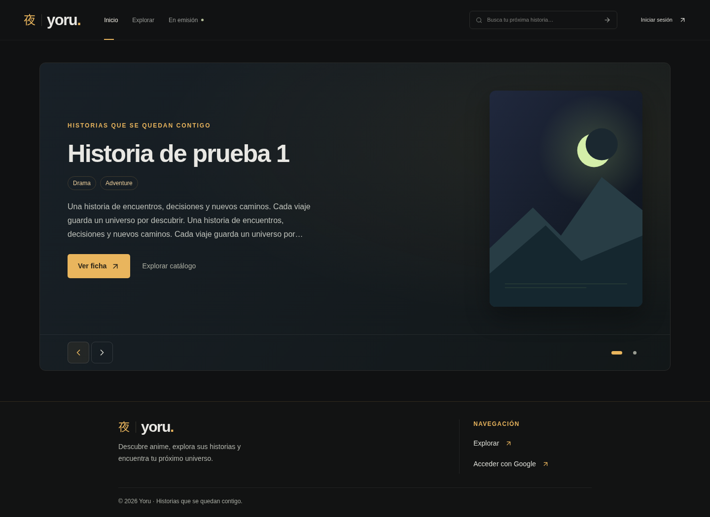

# YORU · carrusel de destacados

Capturas locales con 0, 1, 2, 5 y 20 fichas simuladas. Los títulos, géneros y sinopsis de prueba se suministran exclusivamente desde los mocks E2E; la aplicación usa el catálogo público real. Las imágenes muestran el placeholder original de YORU sin recortes. Se capturan con movimiento reducido para revisar una diapositiva estable.

| Fichas publicadas simuladas | Escritorio · 1440 px | Móvil · 390 px |
| --- | --- | --- |
| 0 · presentación original de YORU | [Ver captura](home-0-1440.png) | [Ver captura](home-0-390.png) |
| 1 · hero estático, sin controles ni repetición inferior | [Ver captura](home-1-1440.png) | [Ver captura](home-1-390.png) |
| 2 · carrusel, sin tarjetas duplicadas | [Ver captura](home-2-1440.png) | [Ver captura](home-2-390.png) |
| 5 · máximo de destacados | [Ver captura](home-5-1440.png) | [Ver captura](home-5-390.png) |
| 20 · cinco destacados y cuadrícula de otros títulos | [Ver captura](home-20-1440.png) | [Ver captura](home-20-390.png) |

## Comportamiento y selección

`Home` conserva `usePublicCatalog(emptyFilters)` y su consulta pública paginada existente. `selectHomeCatalog` (`src/catalog/featured.ts`) elige hasta cinco fichas en el orden que devuelve el catálogo, actualmente por año reciente. Excluye todos sus IDs de la cuadrícula inferior, que muestra hasta doce fichas diferentes; Explorar conserva el acceso al resto del catálogo. Con una sola ficha se muestra únicamente el hero estático; con dos a cinco fichas, solo el carrusel. No se duplican tarjetas para llenar espacios.

La función de selección acepta una lista opcional de IDs preferidos como punto de integración futuro para una selección editorial desde administración. Solo ordena fichas presentes en los datos públicos recibidos e ignora IDs desconocidos; no consulta ni publica borradores. Una fase posterior podrá proporcionar esa lista y cargar las fichas públicas correspondientes si están fuera de la primera página. Esta entrega no incorpora interfaz administrativa, persistencia ni migraciones para destacados.

Solo se monta la portada de la diapositiva activa mediante el componente `CoverImage` existente. La primera tiene prioridad alta. Las otras portadas del carrusel se solicitan al mostrarlas, sin precarga de las cinco. La prueba de carga verifica las rutas firmadas únicas: React Strict Mode puede ejecutar dos veces el efecto de firma en desarrollo.

El cambio automático se produce cada siete segundos. Se suspende con el puntero del ratón sobre el carrusel, al ocultar la pestaña o con movimiento reducido. La interacción táctil, el foco en el contenido y los cambios manuales lo pausan hasta pulsar «Reanudar carrusel». Los controles permiten elegir una diapositiva, avanzar/retroceder, usar flechas de teclado y deslizar horizontalmente. El desplazamiento vertical táctil mantiene su funcionamiento; los cambios conservan el foco. Con `prefers-reduced-motion` no hay animación ni reproducción automática.

## Validación

- Build TypeScript/Vite y `git diff --check` correctos; permanece el aviso previo de bundle principal mayor de 500 kB.
- 34 E2E aprobados: `home-carousel.spec.ts`, `public-catalog.spec.ts` y `real-catalog.spec.ts`, en escritorio y móvil. Suite del carrusel repetida tras ampliar la verificación de títulos largos.
- Los cinco tamaños de catálogo se comprueban a 320, 390, 768, 1024, 1440 y 1920 px en ambos proyectos: enlaces directos, límite de cinco destacados, exclusión de duplicados, controles condicionales y ausencia de desbordamiento horizontal. También se revisan títulos largos y sin espacios, y portadas con `object-fit: contain` y proporción 600:850.
- Casos de reloj controlado para reproducción automática, pausa tras interacción y foco, reanudación, prioridad de la primera portada y movimiento reducido. Gestos táctiles reales de Chromium mediante CDP, comprobando que un deslizamiento horizontal cambia la ficha y uno vertical no activa otra ficha ni navega por accidente.
- La regresión de catálogo valida guardar/sustituir/retirar portadas y su aparición pública, navegación a fichas, publicación, filtros, paginación, errores y reintentos.
- No se modifican Supabase, Storage, autenticación, administración ni dependencias.

## Vista previa con dos fichas

| Escritorio | Móvil |
| --- | --- |
|  |  |
