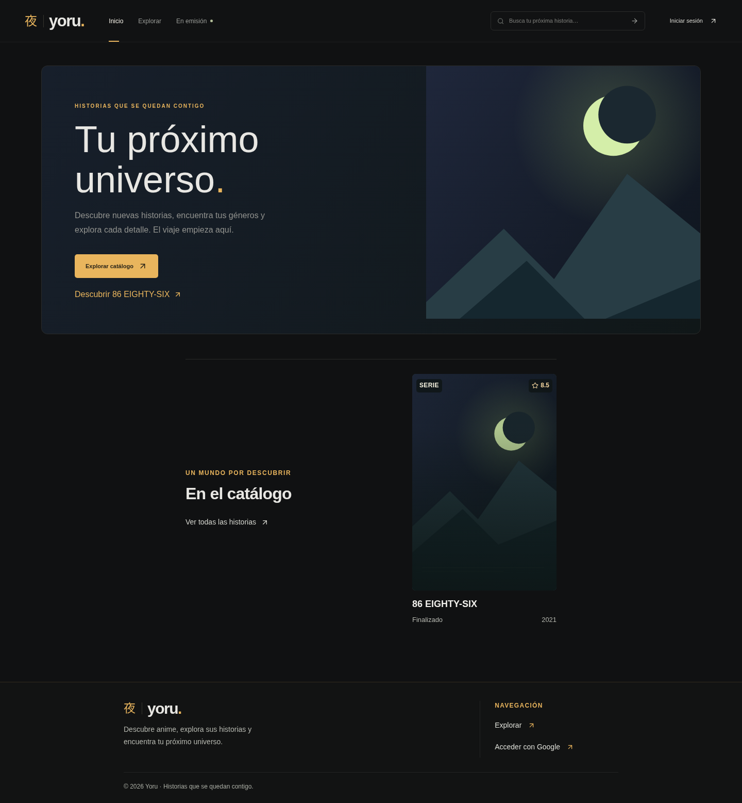
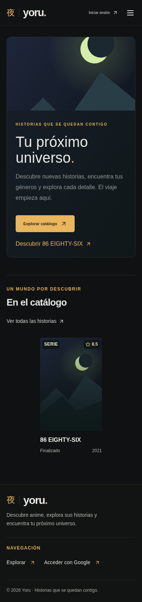
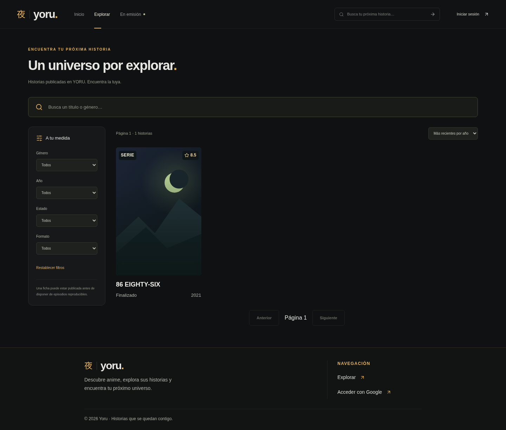
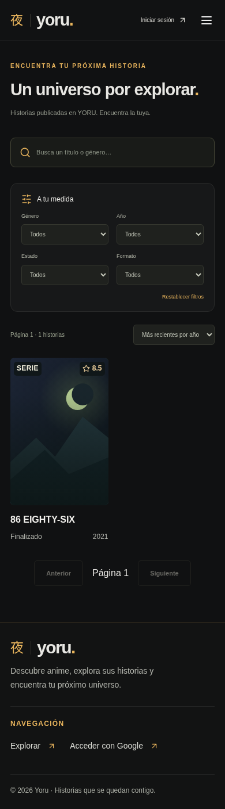
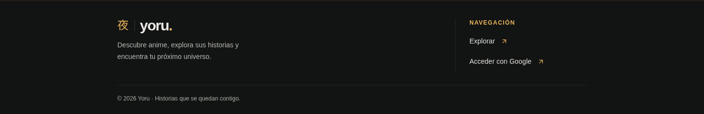

# YORU · tipografía, catálogo y footer

Capturas locales de la PR #10 con respuestas de catálogo simuladas. La ficha y la puntuación mostradas son datos de prueba; estas capturas no modifican el catálogo persistente.

| Vista | Escritorio · 1440 px | Móvil · 390 px |
| --- | --- | --- |
| Inicio, una ficha | [Captura completa](inicio-1440.png) | [Captura completa](inicio-390.png) |
| Explorar, una ficha | [Captura completa](explorar-1440.png) | [Captura completa](explorar-390.png) |
| Footer | [Captura](footer-1440.png) | [Captura](footer-390.png) |

## Validación

- Build TypeScript/Vite y `git diff --check` correctos. Se conserva el aviso previo de bundle principal superior a 500 kB.
- 18/18 E2E de `public-catalog.spec.ts` y `real-catalog.spec.ts`, en escritorio y móvil.
- Comprobación local en Chromium a 320, 390, 768, 1024 y 1440 px, con 1, 10, 50 y 120 registros simulados: 40 combinaciones de Inicio/Explorar, además de la ficha individual en los cinco anchos.
- Títulos de 16–18 px y hasta dos líneas, incluidos títulos largos sin espacios; metadatos de 12–13 px y etiquetas de 12 px. Formatos largos y puntuación de 10.0 sin solapamientos; portadas con proporción 2:3 y sin desbordamiento horizontal.
- Inicio muestra una única tarjeta cuando hay una sola ficha. Con más registros mantiene su límite de 12 tarjetas; Explorar conserva la paginación de 24 resultados y la navegación a la página siguiente.
- La ficha individual conserva su encabezado principal y sinopsis; se ha retirado el bloque superpuesto `detail-art-title`.

## Inicio

| Escritorio | Móvil |
| --- | --- |
|  |  |

## Explorar

| Escritorio | Móvil |
| --- | --- |
|  |  |

## Footer

| Escritorio | Móvil |
| --- | --- |
|  |  |
